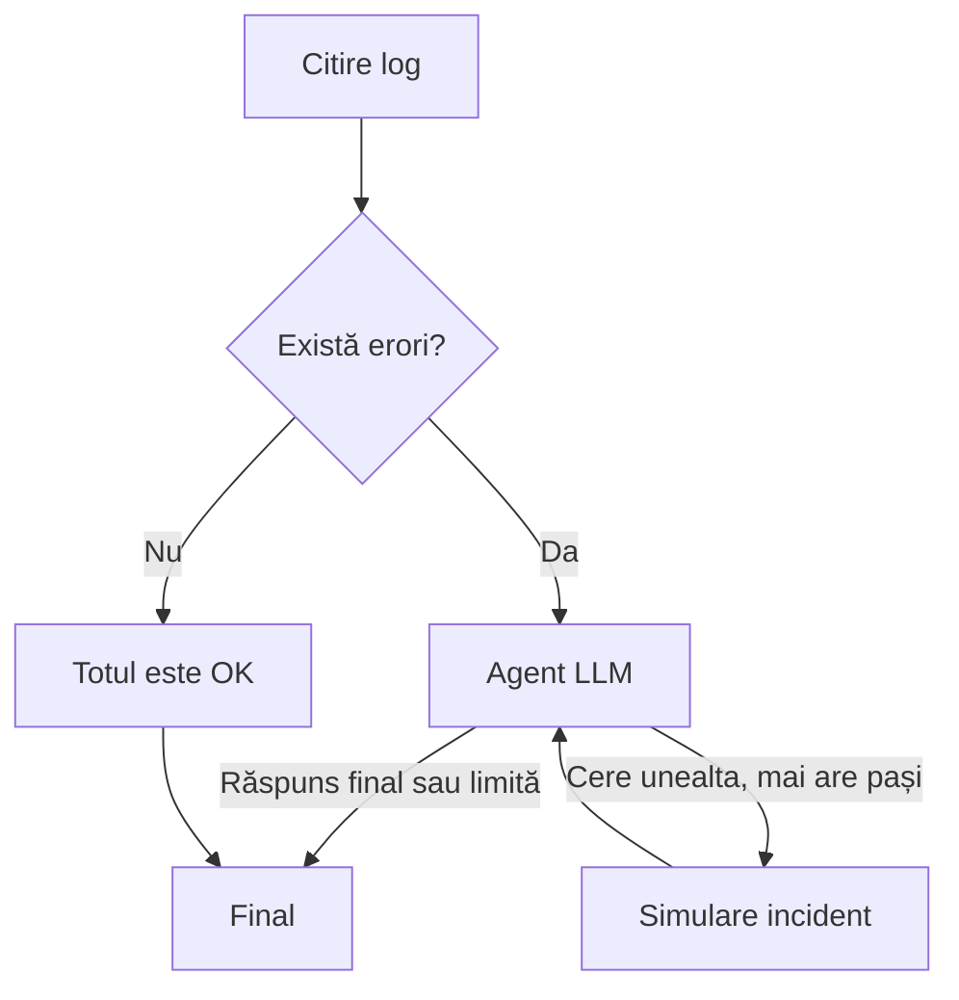

# Lecția 10: agentul într-un graf

Am verificat repository-ul profesorului pe **27 octombrie 2026**.
Față de versiunea recuperată anterior, există un singur commit nou:
[`3a86127`, din 26 octombrie](https://github.com/doublemacro/python-ai/commit/3a861279e8449a00b93399bb32567b1d83b585e8).
El adaugă doar `lesson_10_langgraph.py`. Lecțiile 1–9 și dependențele nu s-au schimbat.

## Ce este nou față de lecția 9

În lecția 9, codul alegea direct ce face după citirea raportului.
În lecția 10, dacă există erori, intră în graf și un agent LLM:

- `messages` păstrează conversația. Funcția `append_messages` adaugă mesajele noi la cele vechi.
- `Annotated` îi arată lui LangGraph ce funcție să folosească pentru această adăugare. Acea funcție se numește reducer.
- `IncidentReport` validează titlul, rezumatul și severitatea: `low`, `medium` sau `high`.
- Modelul cere `create_incident`, Python execută funcția și pune rezultatul într-un mesaj `tool`, cu ID-ul apelului.
- Graful revine la agent după unealtă. Se oprește la răspunsul final sau la limita de 6 pași.



Am păstrat numele funcțiilor de la curs. Am adăugat un mod demo și comentarii
în română. Codul verifică și că incidentul nu se raportează de două ori.
Ca în exemplul profesorului, raportarea este o **simulare**, fără POST către Sentry.

## Cum rulez

Acesta este un exemplu separat de curs. Proiectul final nu folosește LangGraph.
Din folderul `AI-Agentic-Application`, `--with` adaugă bibliotecile doar pentru
rularea acestei lecții, fără să le includă în dependențele proiectului.

Întâi încerc fără cheie și fără consum API:

```powershell
uv run --with langgraph --with requests python lesson_10_langgraph.py --demo
uv run --with langgraph --with requests python lesson_10_langgraph.py --demo --log log_report_ok.txt
```

Primul raport are **2 erori**: agentul cere unealta, apoi dă raportul final,
în **2 pași**. Al doilea are **0 erori**: nu intră deloc în nodul agentului.

Pentru a vedea istoricul adunat de reducer:

```powershell
uv run --with langgraph --with requests python lesson_10_langgraph.py --demo --mesaje
```

Pentru LLM real scot `--demo`:

```powershell
uv run --with langgraph --with requests python lesson_10_langgraph.py
```

Folosesc `API_KEY` și `MODEL` din `.env`; merg și numele de la profesor,
`OPEN_ROUTER_API_KEY` și `OPEN_ROUTER_MODEL_NAME`.
Liniile cu erori sunt trimise la OpenRouter, iar raportarea incidentului rămâne simulată.
Modelul ales trebuie să accepte unelte.

Dacă `uv` nu este în PATH, folosesc `..\.tools\uv\uv.exe` în comenzile de mai sus.

## Ce exersez

1. Rulez cele două rapoarte. Urmăresc de ce primul intră în `call_agent`, iar al doilea merge la `report_all_ok`.
2. Rulez cu `--demo --mesaje`. Caut ordinea `system`, `user`, `assistant`, `tool`, `assistant` și compar ID-ul apelului cu `tool_call_id`.
3. Pun temporar `MAX_AGENT_STEPS = 1`. Rulez demo și observ că se oprește înainte de unealtă. Apoi revin la 6.
4. Copiez `log_report_ok.txt` într-un raport de exercițiu. Adaug o linie cu nivelul `ERROR` și una `INFO` care conține cuvântul `ERROR` în mesaj. Rulez cu `--demo --log log_exercitiu.txt`: trebuie să găsească doar o eroare.

## Verificări minime

```powershell
uv run --with langgraph --with requests python -m pytest tests/test_langgraph_agent.py -q -p no:cacheprovider --basetemp=../.tools/pytest-lectia10
```

Sunt doar trei teste: istoricul și unealta, ramura fără erori, apoi validarea
și oprirea agentului care insistă cu aceeași unealtă. Toate trec.
Am rulat și cele două demonstrații locale; apelul la OpenRouter nu a fost testat live în această actualizare.

## S-a schimbat proiectul final?

În repository-ul public verificat pe 27 octombrie **nu apare un enunț nou,
un termen nou sau o obligație de a folosi LangGraph la proiectul RAG**.
Nu există issue-uri deschise sau release-uri cu asemenea anunțuri.

Proiectul nostru final păstrează cele două programe, ChromaDB, unealta RAG,
validarea Pydantic și citarea sursei și paginii. Lecția nouă este adăugată separat.
Pentru eventuale schimbări anunțate numai pe platforma cursului, GitHub nu este o confirmare.

Surse: [lecția profesorului](https://github.com/doublemacro/python-ai/blob/3a861279e8449a00b93399bb32567b1d83b585e8/lesson_10_langgraph.py),
[reducer-ele LangGraph](https://docs.langchain.com/oss/python/langgraph/graph-api#reducers),
[apelarea uneltelor în OpenAI Docs](https://developers.openai.com/api/docs/guides/function-calling).
