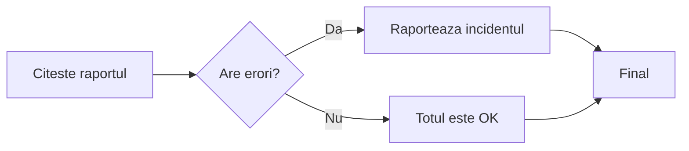

# AI Agentic Application

Teme pentru curs, in Python. Proiect initializat cu uv, teste cu pytest.

Proiectul final este in [proiect_final](proiect_final/README.md): indexare separata,
server Chroma local si agent cu unealta RAG Search, cu input si output validate prin Pydantic.

## Tema 1

In `tema_1.py` citesc datele din `student.json` cu `json.load`, apoi le
validez cu Pydantic: numele este text, varsta este un intreg pozitiv,
iar emailul trebuie sa aiba un format valid.

`Student` este un alt nume pentru `StudentValidator`, fiindca in enunt apar ambele.
`Student(**date)` transmite campurile din dictionar catre clasa pentru validare.

## Rulare

Ai nevoie de [uv](https://docs.astral.sh/uv/getting-started/installation/).
Din folderul proiectului:

```bash
uv sync --locked
uv run python tema_1.py
uv run python -m pytest
```

Exemplul din tema afiseaza:

```text
Ana Popescu, 20 ani, ana.popescu@example.com
```

## Alte exemple

In `exemple/` sunt inca trei studenti: Mihai (22 ani), Elena (19 ani)
si Andrei (24 ani). Poti alege fisierul la rulare:

```bash
uv run python tema_1.py exemple/mihai.json
uv run python tema_1.py exemple/elena.json
uv run python tema_1.py exemple/andrei.json
```

Testul citeste `student.json` si verifica datele Anei. Celelalte fisiere sunt
exemple pe care le poti rula separat. Adresele de email sunt fictive.

## Tema 2

`tema2.py` foloseste OpenAI + OpenRouter, ca in exemplul de la curs.
Agentul apeleaza mai intai `listeaza_fisiere`, apoi `cauta_cuvant` pentru `pytest`
si afiseaza fisierele gasite. `tool_choice` fixeaza ordinea celor doua apeluri.

Uneltele folosesc Python pentru listare si cautare, ca sa mearga si pe Windows,
si pe Linux. Cautarea include subfolderele si ignora diferenta intre litere mari
si mici. Sunt excluse `.git`, `.venv`, cache-urile Python/pytest, `chroma_db`,
`.model_cache` si fisierele `.env`.
Fisierele care nu pot fi citite ca text UTF-8 sunt sarite.

Copiaza `.env.example` in `.env` si completeaza `API_KEY` cu cheia ta OpenRouter.
`MODEL=cohere/north-mini-code:free` foloseste Cohere North Mini Code gratuit, cu suport pentru unelte.
Cheia se creeaza in [OpenRouter](https://openrouter.ai/settings/keys).
OpenRouter este un serviciu online, accesat prin biblioteca `openai`.
Cheia ramane locala, nu se publica pe GitHub.

```bash
uv sync --locked
uv run python tema2.py
uv run python -m pytest tests/test_tema2.py
```

Printre rezultate trebuie sa apara `pyproject.toml` si `tests/test_tema2.py`.
Testul ruleaza unealta reala de cautare si verifica daca rezultatul contine
`pyproject.toml`, asa cum permite cerinta. Nu foloseste simulari si nu testeaza
raspunsul LLM-ului. Pentru rularea agentului ai nevoie de cheia OpenRouter.

Referinta: [apelarea uneltelor](https://developers.openai.com/api/docs/guides/function-calling).

Protectii: cheia sta in `.env`, ignorat de Git si de unelte. Agentul poate doar
lista si cauta in proiect, fara comenzi de shell sau modificari de fisiere.
Nu urmareste legaturi catre alte foldere. Trimite modelului numai nume de fisiere,
nu continutul lor. Sunt cel mult 3 cereri, cu timeout de 60 secunde fiecare,
maximum 1024 tokenuri de raspuns per cerere si fara reincercari automate.

## Lectiile recuperate

Exemple adaptate dupa [repository-ul profesorului](https://github.com/doublemacro/python-ai/tree/279c1072d5259bde2bbc3863f482295adbf2feb4),
versiunea `279c107`, verificata pe 22 octombrie 2026. Am pastrat numele
fisierelor de la curs si am explicat pasii in comentarii in romana.

| Fisier | Ce exersez |
| --- | --- |
| `01_fundamentals.py` | Variabile, liste, dictionare, functii, if, for, while si input |
| `lesson_02_classes_objects.py` | Clasa User, obiecte, metode, set si JSON |
| `lesson_03_data_validation.py` | Pydantic, limite pentru campuri, adresa si tratarea erorilor |
| `lesson_04_types.py` | type, isinstance si adnotari de tip |
| `lesson_05_json_data.py` | Citirea si validarea datelor din user_data.json |
| `lesson_06_simplest_agent.py` | Agent cu unelte pentru teste, rezumate si numarat cuvinte |
| `lesson_07_string_manipulation.py` | Indexare, lower, split, join, count si citirea unui text |
| `lesson_08_semantic_search.py` | PDF-uri, embeddings, BM25, cautare hibrida si unelte pentru agent |
| `lesson_09_langgraph.py` | Stare, noduri, ramuri conditionale si analiza logurilor |
| `99_temp.py` | Afisarea liniilor care contin un cuvant intreg |
| `workshop_cuvinte.py` | Rezolvarea exercitiului din t.txt |
| `main_target.py` | Varianta agentului care are doar unealta pentru teste |
| `main.py` | Exemplul initial cu o functie de salut |

`user_data.json`, `paragraphs.txt`, `t.txt`, `StarMaker.pdf`, `invoices.pdf`,
`info.json`, `log_report.txt`, `log_report_ok.txt`, `pytest.ini` si testele de
validare sunt preluate din repository-ul profesorului. Pentru lectiile 8 si 9
bibliotecile se instaleaza prin extra `semantic-search`, respectiv `langgraph`.

Parcurg lectiile in ordinea numerelor. Fiecare se ruleaza separat, de exemplu:

```bash
uv run python 01_fundamentals.py
uv run python lesson_05_json_data.py
uv run python lesson_07_string_manipulation.py
uv run python workshop_cuvinte.py
uv run python -m pytest
```

In prima lectie scriu `q` ca sa ies din bucla de citire.
Exercitiul workshop trebuie sa afiseze 8 aparitii pentru `marcus` si 51 de
cuvinte in total. Cautarea ignora majusculele si semnele de punctuatie;
`marcus123` nu este acelasi cuvant ca `marcus`.

## Agentul din lectia 6

Foloseste `API_KEY` si `MODEL` din acelasi `.env` ca tema 2. Accepta si
`OPEN_ROUTER_API_KEY` / `OPEN_ROUTER_MODEL_NAME`, numele de la profesor.
Daca sunt prezente ambele variante, `API_KEY` si `MODEL` au prioritate.

```bash
uv run python lesson_06_simplest_agent.py
```

Exemple de mesaje:

- `Ruleaza testele din tests/test_validations.py.`
- `Numara cuvintele marcus si notebook din paragraphs.txt.`
- `Fa un rezumat pentru paragraphs.txt.`
- `quit` pentru iesire.

Modelul cere o unealta, Python executa functia si trimite rezultatul inapoi,
iar modelul formuleaza raspunsul final. Fluxul urmeaza exemplul de
[function calling din documentatia OpenAI](https://developers.openai.com/api/docs/guides/function-calling).
Pentru rezumate, modelul ales pe OpenRouter trebuie sa accepte si raspunsuri
structurate cu `json_schema`. Disponibilitatea modelului depinde de furnizor.

Spre deosebire de tema 2, rezumarea trimite continutul fisierului ales la
OpenRouter. Citirea exclude fisierele ascunse (inclusiv `.env`), iesirea din
proiect si fisierele de peste 100 KB. Numaram cuvintele local, iar testele
ruleaza cu acelasi Python ca agentul, inclusiv pe Windows.

`tests/test_lectii.py` verifica numararea, restrictiile de citire, rularea unui
test real si fluxul uneltelor cu raspunsuri simulate. Testele nu consuma API.
Apelurile reale catre OpenRouter nu au fost verificate in aceasta completare.

## Lectia 8: cautare semantica si hibrida in PDF-uri

Pornim de la `StarMaker.pdf` si `invoices.pdf`, exact ca la curs. Citim textul paginilor,
il impartim in bucati, transformam bucatile in liste de numere (embeddings),
apoi le salvam in Chroma. Transformam si intrebarea in numere si cautam
bucatile cu sens apropiat. La final, putem cere modelului un raspuns folosind
doar acele fragmente. Acest ultim pas se numeste RAG.

In varianta noua combinam cautarea semantica cu BM25. Prima cauta dupa sens,
iar BM25 ajuta la potriviri de cuvinte si coduri, de exemplu `INV-2026-1003`.
Combinam pozitiile din cele doua clasamente: locul 1 primeste 1 punct,
locul 2 primeste 1/2 si asa mai departe. Primele 8 fragmente merg in raspuns.
La reindexare refacem intrarile acelui PDF, ca sa evitam duplicatele.

Modelul de embeddings ruleaza local; OpenRouter este folosit pentru formularea
raspunsului. Sunt doua modele cu roluri diferite. Pentru prima incercare
folosim `--fara-llm`, ca sa vedem cautarea separat.

Din folderul `AI-Agentic-Application`, in terminalul PowerShell:

```powershell
uv sync --locked --extra semantic-search
uv run --extra semantic-search python lesson_08_semantic_search.py --fara-llm
```

Daca `uv` nu este recunoscut in terminal, in acest workspace exista deja
executabilul local. Aceleasi comenzi se pot rula asa:

```powershell
..\.tools\uv\uv.exe sync --locked --extra semantic-search
..\.tools\uv\uv.exe run --extra semantic-search python lesson_08_semantic_search.py --fara-llm
```

Prima rulare descarca modelul de embeddings si poate dura mai mult.
Programul afiseaza numarul de bucati indexate, apoi asteapta la `tu>`.
Scrie cate o intrebare, de exemplu:

```text
What does the narrator see when looking at the stars?
How does the narrator travel through the universe?
Who is the Star Maker?
What is the amount due for INV-2026-1003?
quit
```

PDF-ul este in engleza, asa ca incepem cu intrebari in engleza pentru acest
model. Fiecare fragment afisat are sursa si numarul paginii din PDF.
Deschide pagina indicata si compara textul: o cautare semantica gaseste
fragmente apropiate ca sens, dar nu garanteaza ca fiecare contine raspunsul.
Pentru factura `INV-2026-1003`, cauta printre rezultate pagina 3 din
`invoices.pdf`, cu suma `$2,175.00`. Verifica numarul facturii din fragment,
fiindca paginile au un format asemanator si pot primi scoruri apropiate.

Ca sa compari cu varianta initiala, foloseste doar cautarea semantica intr-un PDF:

```powershell
uv run --extra semantic-search python lesson_08_semantic_search.py --fara-llm --doar-semantic --pdf StarMaker.pdf
```

Pentru raspunsuri in romana, folosind `API_KEY` si `MODEL` din `.env`:

```powershell
uv run --extra semantic-search python lesson_08_semantic_search.py
```

Agentul cere unealta `search_starmaker` pentru intrebarile despre PDF-uri.
Python valideaza intrebarea, cauta fragmentele, cere raspunsul din context si
trimite rezultatul inapoi agentului. Pentru un salut sau alta conversatie,
modelul poate raspunde direct. Folosim `API_KEY` si `MODEL` din `.env`, cu aceeasi
compatibilitate pentru numele variabilelor de la profesor.

Varianta cu agent trimite intrebarea si fragmentele gasite la OpenRouter.
Poti compara citatiile cu fragmentele afisate in varianta `--fara-llm`.
`quit` opreste ambele variante. Baza `chroma_db/` si modelul `.model_cache/`
raman locale si nu se trimit pe GitHub.

Bibliotecile folosite: [Chroma](https://docs.trychroma.com/reference/python/collection),
[PyMuPDF4LLM](https://pymupdf.readthedocs.io/en/latest/pymupdf4llm/api.html)
si [Sentence Transformers](https://sbert.net/docs/package_reference/sentence_transformer/model.html).
Pentru BM25 folosim [rank_bm25](https://github.com/dorianbrown/rank_bm25).

## Exercitii pentru lectia 8

Fa-le in ordine si noteaza ce ai observat. Nu trebuie sa rescrii tot programul.

1. **Intelege bucatile de text.** Ruleaza comanda de mai jos. Ar trebui sa
   vezi `[800, 800, 240]`: pasul este 680, iar ultimele 120 de caractere dintr-o
   bucata sunt repetate la inceputul urmatoarei.

   ```powershell
   uv run python -c "from lesson_08_semantic_search import chunk_text; print([len(x) for x in chunk_text('a' * 1600)])"
   ```

2. **Compara doua formulari.** In varianta `--fara-llm`, intreaba
   `How does the narrator travel through the universe?`, apoi
   `How does the storyteller explore the cosmos?`. Noteaza paginile gasite.
   Cate sunt comune? De ce poate gasi texte chiar daca nu folosesti aceleasi cuvinte?

3. **Schimba marimea bucatilor.** In `lesson_08_semantic_search.py`, pune
   `CHUNK_SIZE = 400` si `CHUNK_OVERLAP = 60`, apoi reporneste programul.
   Noteaza numarul nou de bucati si compara fragmentele pentru aceeasi intrebare.
   La final revino la 800 si 120.

4. **Citeste scorurile.** Porneste cu `--fara-llm --doar-semantic`.
   Rezultatul cautarii contine si `result['distances'][0]`.
   Adauga temporar `print(result['distances'][0])` dupa cautarea semantica, in `main`.
   Compara primele distante cu fragmentele. O distanta cosinus mai mica
   inseamna ca vectorii sunt mai apropiati; nu este un procent de adevar.

5. **Verifica factura.** Intreaba `What is the amount due for INV-2026-1003?`,
   apoi verifica pagina 3 din `invoices.pdf`. Compara cautarea hibrida cu
   `--doar-semantic`. Porneste si varianta cu agent si verifica pagina citata.

Pentru recapitularea lectiei 7, ruleaza `uv run python workshop_cuvinte.py`:
trebuie sa obtii 8 aparitii pentru `marcus` si 51 de cuvinte in total.

Testele lectiei 8 ruleaza si fara descarcarea modelului sau cheie API:

```powershell
uv run python -m pytest tests/test_semantic_search.py -q
uv run python -m pytest -q
```

## Ultima lectie: 9, LangGraph si rapoarte de log

`State` tine numele raportului, erorile gasite si raspunsul. Fiecare nod este
o functie Python care primeste starea si intoarce campurile schimbate.
O muchie conditionala alege urmatorul nod dupa citirea raportului.
`compile()` pregateste graful, iar `invoke()` il ruleaza cu starea initiala.



Instaleaza toate bibliotecile cursului:

```powershell
uv sync --locked --extra semantic-search --extra langgraph
```

Pentru aceasta lectie sunt suficiente `uv sync --locked --extra langgraph` si
Python; nu ai nevoie de modelul de embeddings sau de cheie OpenRouter.

Ruleaza cele doua exemple, pe rand:

```powershell
uv run --extra langgraph python lesson_09_langgraph.py
uv run --extra langgraph python lesson_09_langgraph.py --log log_report_ok.txt
```

Primul gaseste **2 erori** si simuleaza raportarea unui incident.
Al doilea gaseste **0 erori** si alege nodul `report_all_ok`.
Programul verifica nivelul de log de dupa data si ora, astfel ca un mesaj
`INFO` care contine cuvantul `ERROR` ramane o linie informativa.

Daca `uv` nu este in PATH, foloseste executabilul `..\.tools\uv\uv.exe`
in loc de `uv`. Bibliotecile sunt deja instalate in mediul virtual local,
deci poti rula si direct:

```powershell
.\.venv\Scripts\python.exe lesson_09_langgraph.py
.\.venv\Scripts\python.exe lesson_09_langgraph.py --log log_report_ok.txt
```

Pentru cererea HTTP de demonstratie de la curs:

```powershell
uv run --extra langgraph python lesson_09_langgraph.py --api
```

`--api` trimite un POST la JSONPlaceholder cu numarul de erori in titlu.
Serviciul simuleaza crearea unui element si nu salveaza un incident real.
Fara acest argument, exemplul ruleaza local, cu raspuns simulat.
Fluxul urmeaza [Graph API din documentatia LangGraph](https://docs.langchain.com/oss/python/langgraph/graph-api).

## Exercitii pentru lectia 9

1. Ruleaza ambele rapoarte si urmareste ce nod se executa dupa citire.
   Deschide `build_graph()` si gaseste linia care face alegerea intre ramuri.
2. Copiaza `log_report_ok.txt` in `log_exercitiu.txt` si adauga o linie
   `2026-10-22 10:00:00 ERROR Connection failed`. Ruleaza cu
   `--log log_exercitiu.txt`: trebuie sa gasesti o eroare.
3. Adauga o linie `2026-10-22 10:01:00 INFO No ERROR found` in acelasi fisier.
   Numarul de erori trebuie sa ramana 1. Explica de ce.
4. Adauga in `State` un camp `warnings` si numara separat liniile cu nivel
   `WARNING`. In raportul profesorului sunt doua. Pastreaza decizia de incident
   bazata pe `errors`, ca sa vezi diferenta dintre date si alegerea ramurii.
5. Pentru recapitularea JSON, citeste `info.json` cu `json.load` si afiseaza
   mesajele din `logs` care au `level == "ERROR"`. Trebuie sa gasesti un mesaj.

## Verificare

```powershell
uv run --extra semantic-search --extra langgraph python -m pytest -q
```

Pe 22 octombrie 2026, cele 43 de teste trec. Acopera cautarea hibrida,
argumentele uneltelor, pastrarea surselor, ambele ramuri LangGraph si erorile
API-ului demo. Cererile OpenRouter si POST sunt simulate in teste.
Cautarea in PDF-uri este verificata separat cu modelul local real: 132 de
fragmente din carte si 4 din facturi. Factura `INV-2026-1003` apare intre
rezultate la pagina 3, iar reindexarea pastreaza numarul de fragmente.

## Temele RAG Search

Cele trei programe folosesc `data_sources/`. Am pus acolo fisierele de exemplu
`paragraphs.txt`, `StarMaker.pdf` si `invoices.pdf`. Poti adauga alte PDF-uri
sau fisiere text UTF-8 in acelasi folder. Programul incarca toate fisierele
obisnuite din folder, iar cele goale sau care nu pot fi citite sunt sarite.
Subfolderele si fisierele ascunse sunt ignorate.

Pentru PDF-uri pastram pagina reala, numarata de la 1. Pentru un fisier text,
tot continutul este considerat pagina 1. `source` este mereu numele fisierului.
Baza acestor teme este separata de lectia 8, in `chroma_db/teme_rag/`.
La fiecare pornire sunt reincarcate sursele, ca sa nu ramana date vechi.

Bibliotecile sunt aceleasi ca pentru lectia 8:

```powershell
uv sync --locked --extra semantic-search
```

Cheia si modelul OpenRouter se citesc din `.env`, ca in celelalte teme.
Comenzile de mai jos se ruleaza din `AI-Agentic-Application`.

### Tema 3.1: cautare intr-un fisier ales

Cod: [tema_3_1.py](tema_3_1.py).

```powershell
.\.venv\Scripts\python.exe tema_3_1.py
```

Programul imparte textul in bucati de 800 de caractere, cu 120 comune intre
bucati, calculeaza embeddings si le incarca in Chroma. La introducerea unei
intrebari verifica mai intai daca exista sursa. Apoi foloseste
`collection.query(n_results=3, where={"source": sursa}, ...)`.
LLM-ul primeste cele cel mult trei fragmente si trebuie sa raspunda in romana,
cu numele fisierului si pagina.

Scrie numele exact al fisierului, apoi o virgula si intrebarea:

```text
paragraphs.txt, Despre cine este vorba in text?
nu_exista.txt, Cine apare in text?
quit
```

Pentru prima intrebare, raspunsul trebuie sa vorbeasca despre Marcus si sa
citeze `paragraphs.txt`, pagina 1. Pentru a doua, programul anunta ca nu are
date despre acel fisier.

### Tema 3.2: limita pentru distanta cosinus

Cod: [tema_3_2.py](tema_3_2.py). Refoloseste citirea, ingestion-ul si cautarea
din prima tema, apoi elimina rezultatele cu `distance > 0.5`.

```powershell
.\.venv\Scripts\python.exe tema_3_2.py
```

O distanta mai mica este mai buna. Valoarea `0.5` este acceptata.
Daca nu ramane niciun fragment, afiseaza `Nu s-a gasit niciun rezultat relevant.`
si nu face cererea catre LLM.

Fisierele exemplu sunt in engleza. Pentru a verifica filtrarea, incearca:

```text
paragraphs.txt, What did Marcus do during the meeting?
paragraphs.txt, How to replace a car engine cylinder?
quit
```

### Tema optionala: 15 candidati, reranking, top 4

Cod: [tema_3_optionala.py](tema_3_optionala.py).

Am folosit strategia [Retrieve & Re-Rank din documentatia Sentence Transformers](https://www.sbert.net/examples/sentence_transformer/applications/retrieve_rerank/README.html).
Cautarea aduce pana la 15 fragmente din sursa ceruta. Pastram limita de distanta
din tema 3.2, apoi un `CrossEncoder` citeste perechile intrebare-fragment si
le ordoneaza dupa relevanta. Folosim modelul `cross-encoder/ms-marco-MiniLM-L6-v2`.

Conform [documentatiei CrossEncoder](https://sbert.net/docs/cross_encoder/usage/usage.html),
`Sigmoid` transforma scorurile acestui model in valori intre 0 si 1.
Aici scorul mai mare este mai bun. Pastram scoruri de cel putin `0.5` si trimitem
LLM-ului cel mult primele 4 rezultate. Daca toate sunt eliminate, afisam mesajul
de lipsa a rezultatelor, fara sa apelam LLM-ul.

```powershell
.\.venv\Scripts\python.exe tema_3_optionala.py
```

La prima rulare se descarca si modelul de reranking. Pentru verificare:

```text
paragraphs.txt, What did Marcus do during the meeting?
StarMaker.pdf, What is the recipe for a chocolate cake?
quit
```

### Verificari minime pentru cele trei teme

Pentru a vedea doar fragmentele, fara consum OpenRouter, adauga `--fara-llm`:

```powershell
.\.venv\Scripts\python.exe tema_3_1.py --fara-llm
.\.venv\Scripts\python.exe tema_3_2.py --fara-llm
.\.venv\Scripts\python.exe tema_3_optionala.py --fara-llm
.\.venv\Scripts\python.exe -m pytest tests/test_teme_rag.py -q
```

Sunt doar trei teste: filtrarea pe sursa, pragul distantei si selectarea top 4
dupa reranking. Verifica si ca lipsa rezultatelor opreste apelul LLM.
